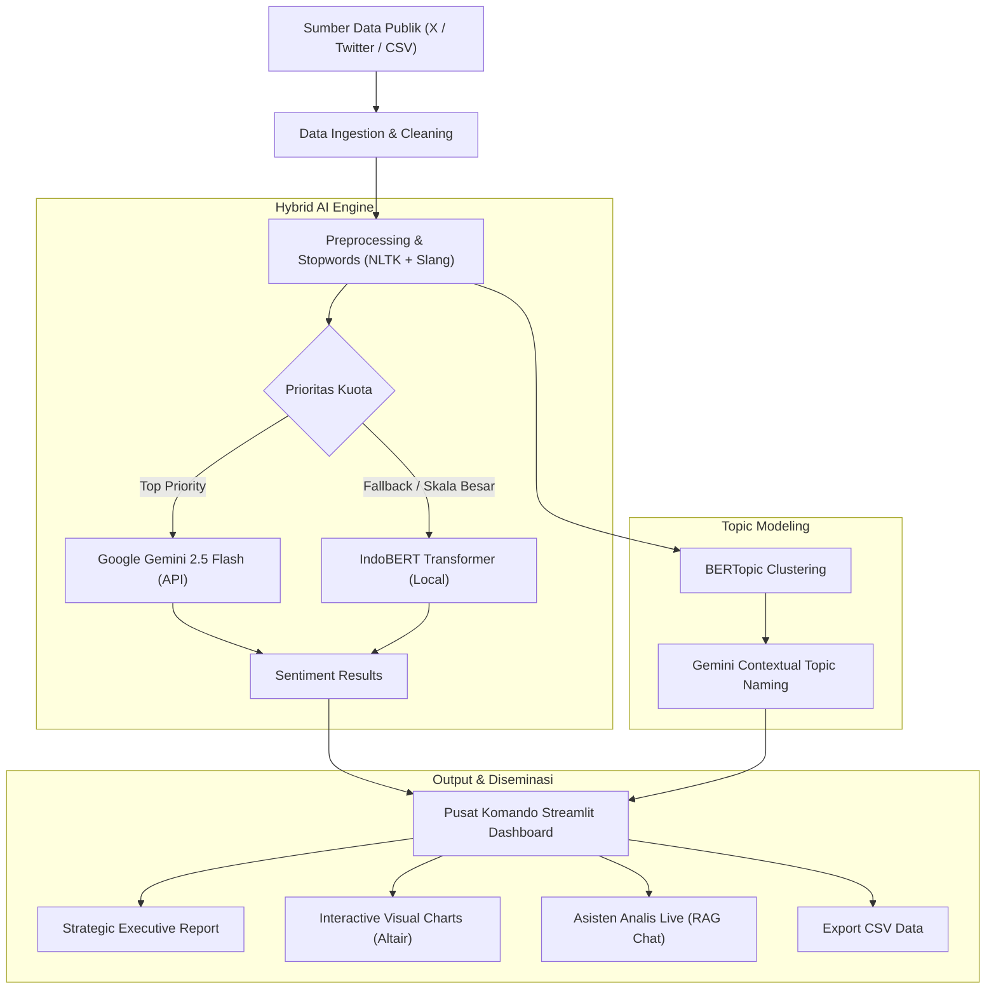

<div align="center">

# 🛡️ Defense Sentiment Intelligence Dashboard
### Platform Analisis Sentimen & Intelijen Opini Publik Isu Strategis Pertahanan RI
*Direktorat Jenderal Strategi Pertahanan (Ditjen Strahan) — Kementerian Pertahanan RI*

[](https://www.python.org/)
[](https://streamlit.io/)
[](https://aistudio.google.com/)
[](https://huggingface.co/mdhugol/indonesia-bert-sentiment-classification)
[](https://maartengr.github.io/BERTopic/)
[](LICENSE)

</div>

---

## 📌 Ringkasan Eksekutif & Latar Belakang

Proyek ini dikembangkan sebagai bagian dari portofolio **Praktik Kerja Lapangan (PKL) di Direktorat Jenderal Strategi Pertahanan (Ditjen Strahan), Kementerian Pertahanan Republik Indonesia**. 

Dalam era perang informasi (*information warfare*) dan diplomasi pertahanan modern, persepsi serta sentimen publik di ruang siber (khususnya platform **X / Twitter**) memiliki peran krusial terhadap legitimasi kebijakan pertahanan negara, seperti:
- Modernisasi Alutsista (TNI AD, TNI AL, TNI AU)
- Kedaulatan wilayah perbatasan dan Laut Natuna Utara
- Kebijakan anggaran dan kerja sama pertahanan bilateral
- Isu Komando Cadangan (Komcad) & ketahanan nasional

Aplikasi ini menyajikan **Pusat Komando Analisis Opini Publik** berbasis **Hybrid Artificial Intelligence**, menggabungkan kecepatan pemrosesan model transformer lokal (**IndoBERT**) dengan kedalaman analisis penalaran (*reasoning*) Large Language Model (**Google Gemini 2.5 Flash**), dilengkapi pemodelan topik (**BERTopic**) dan asisten intelijen interaktif.

---

## 🚀 Fitur-Fitur Utama

1. **📡 Multi-Mode Data Acquisition**:
   - **Live Scraping X (Twitter)**: Akuisisi data real-time berbasis kata kunci isu pertahanan menggunakan `tweet-harvest`.
   - **Sample Dataset Bawaan**: Siap diuji langsung menggunakan data tersanitasi `data/sample_alutsista.csv` tanpa memerlukan token Twitter.
   - **Unggah CSV Mandiri**: Fleksibilitas menganalisis file dataset CSV eksternal.

2. **🧠 Hybrid AI Sentiment Classification**:
   - **Google Gemini 2.5 Flash**: Menganalisis konteks bahasa Indonesia kompleks, slang, dan sentimen tersirat dengan mekanisme **Exponential Backoff Retry** (`tenacity`) untuk menangani kuota API.
   - **IndoBERT Pipeline**: Model transformer berbahasa Indonesia (`indonesia-bert-sentiment-classification`) bertindak sebagai fallback tangguh dan efisien untuk pemrosesan volume data tinggi.

3. **🔎 Topic Modeling & Auto-Naming (BERTopic)**:
   - Mengelompokkan narasi masyarakat ke dalam kluster sub-isu spesifik.
   - Nama topik digenerate secara ringkas dan profesional oleh AI Gemini berdasarkan kata kunci kluster dominan.

4. **📝 Laporan Intelijen Strategis Otomatis**:
   - AI menyusun *Executive Summary* berformat standar staf intelijen/analis pertahanan:
     1. Situasi Terkini & Distribusi Sentimen
     2. Potensi Risiko terhadap Stabilitas / Kebijakan
     3. 3 Rekomendasi Aksi Konkret bagi Pengambil Keputusan

5. **💬 Asisten Intelijen Live (Context-Aware Q&A)**:
   - Chatbot berbasis LLM yang disuntikkan konteks data sentimen dan tweet terkini (*mini-RAG*).
   - Menjawab pertanyaan taktis dari komandan/analis secara terarah hanya berdasarkan data yang diperoleh.

6. **📊 Visualisasi Data Interaktif**:
   - **Donut Chart** proporsi sentimen (Positif, Netral, Negatif) dengan persentase presisi (Altair).
   - **Horizontal Bar Chart** distribusi sentimen per sub-topik isu.
   - **Word Cloud Dinamis** dengan stopword filtering bahasa Indonesia (baku + slang + noise).
   - **AI Explainer**: Penjelasan naratif otomatis mengapa kata-kata tertentu dominan pada isu tersebut.

---

## 🏗️ Arsitektur Sistem



---

## 📁 Struktur Repositori

```text
├── data/
│   └── sample_alutsista.csv       # Dataset sampel isu pertahanan untuk uji coba instan
├── app.py                         # Kode aplikasi utama Streamlit Dashboard
├── SentimenAnalisis_V9-FInal.ipynb # Notebook Colab (Scraping, Setup, Ngrok Tunnel)
├── requirements.txt               # Daftar pustaka & dependensi Python
├── .env.example                   # Contoh konfigurasi environment variable
├── .gitignore                     # Aturan pengecualian file sensitif / cache
├── LICENSE                        # Lisensi open-source (MIT)
└── README.md                      # Dokumentasi komprehensif proyek
```

---

## ⚙️ Panduan Instalasi & Penggunaan

### Opsi A: Menjalankan Secara Lokal (Rekomendasi)

#### 1. Clone Repositori
```bash
git clone https://github.com/USERNAME_ANDA/sentimen-analisis-pkl-menhan.git
cd sentimen-analisis-pkl-menhan
```

#### 2. Buat & Aktifkan Virtual Environment
```bash
# Windows
python -m venv venv
.\venv\Scripts\activate

# Linux / macOS
python3 -m venv venv
source venv/bin/activate
```

#### 3. Instalasi Dependensi
```bash
pip install --upgrade pip
pip install -r requirements.txt
```

> **Catatan Scraping X (Opsional):** Jika ingin menggunakan fitur live scraping Twitter, pastikan telah menginstal [Node.js](https://nodejs.org/) (versi 18+) agar perintah `npx` dapat berjalan.

#### 4. Konfigurasi Environment (Opsional)
Salin `.env.example` menjadi `.env` lalu masukkan API Key Anda:
```bash
cp .env.example .env
```
Isi nilai:
- `GEMINI_API_KEY`: Dapatkan gratis di [Google AI Studio](https://aistudio.google.com/).
- `TWITTER_AUTH_TOKEN`: Token autentikasi akun X Anda (jika menggunakan live scraping).

#### 5. Jalankan Aplikasi
```bash
streamlit run app.py
```
Aplikasi akan otomatis terbuka di browser pada alamat `http://localhost:8501`.

---

### Opsi B: Menjalankan di Google Colab

Jika tidak memiliki GPU atau Node.js lokal, Anda dapat menjalankan notebook `SentimenAnalisis_V9-FInal.ipynb` langsung di Google Colab:
1. Upload `SentimenAnalisis_V9-FInal.ipynb` ke Google Colab.
2. Jalankan **Cell 0** untuk instalasi Node.js, Playwright, dan library Python.
3. Jalankan **Cell 1** untuk mengekstrak `app.py`.
4. Jalankan **Cell 2**, masukkan **Ngrok Auth Token** gratis dari [dashboard.ngrok.com](https://dashboard.ngrok.com/), dan buka URL publik yang dihasilkan.

---

## 🛡️ Keamanan & Etika Data

- **Sumber Terbuka (OSINT)**: Seluruh data yang dianalisis dalam proyek ini merupakan data yang dapat diakses publik dari platform media sosial terbuka.
- **Kerahasiaan Negara**: Proyek ini **TIDAK** memuat atau memproses dokumen, data internal, maupun informasi rahasia pertahanan negara.
- **Perlindungan Kredensial**: Repositori ini telah dikonfigurasi dengan aturan `.gitignore` ketat untuk mencegah kebocoran API Key, token otentikasi, maupun kredensial pribadi ke publik.

---

## 🛠️ Tech Stack & Libraries

| Kategori | Teknologi / Pustaka |
| :--- | :--- |
| **Bahasa Utama** | Python 3.10+ |
| **Framework Web** | [Streamlit](https://streamlit.io/) |
| **Large Language Model** | [Google Gemini 2.5 Flash](https://ai.google.dev/) via `google-generativeai` |
| **Transformer Model** | [IndoBERT](https://huggingface.co/mdhugol/indonesia-bert-sentiment-classification) via Hugging Face `transformers` & `torch` |
| **Topic Modeling** | [BERTopic](https://github.com/MaartenGr/BERTopic), `scikit-learn` |
| **Visualisasi Data** | `Altair`, `Matplotlib`, `WordCloud` |
| **Pemrosesan Teks** | `NLTK`, `Regex` |
| **Scraping Engine** | `tweet-harvest` (Node.js/npx) |
| **Resilience & Retry** | `tenacity` (Exponential Backoff) |

---

## 👨‍💻 Kontributor

- **Pengembang**: Analis Data & AI Enthusiast (Praktik Kerja Lapangan)
- **Instansi**: Ditjen Strategi Pertahanan, Kementerian Pertahanan Republik Indonesia
- **Tujuan**: Portofolio Pengembangan Aplikasi NLP, Sentiment Analysis, dan AI Intelligence Dashboard

---

## 📄 Lisensi

Proyek ini didistribusikan di bawah lisensi **MIT License**. Silakan merujuk ke file [LICENSE](LICENSE) untuk informasi lebih lanjut.
